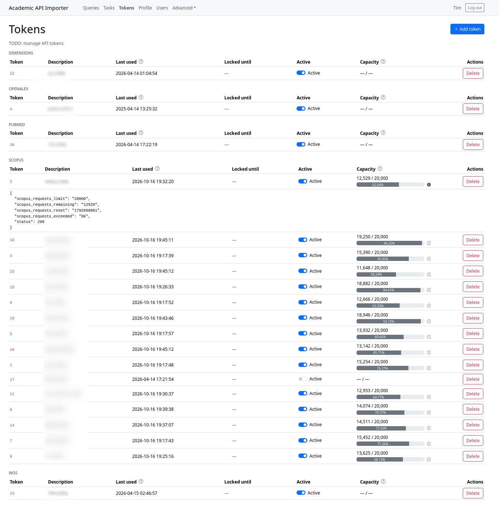
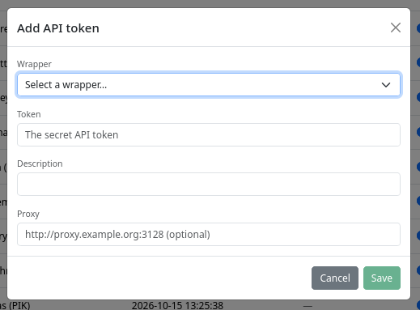
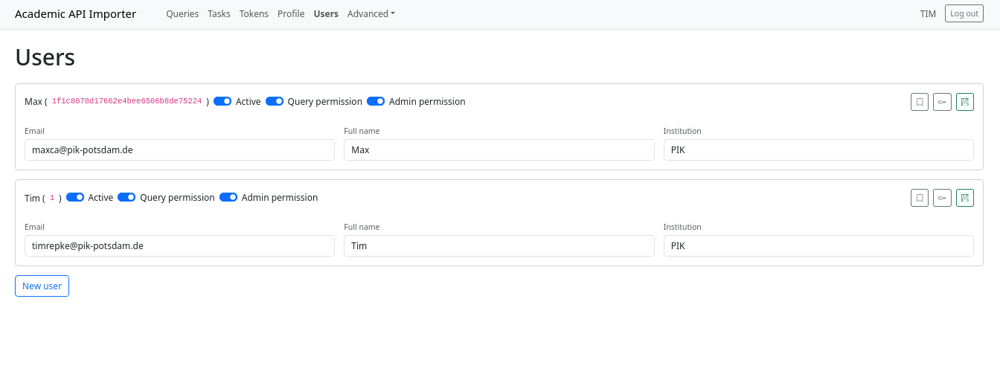
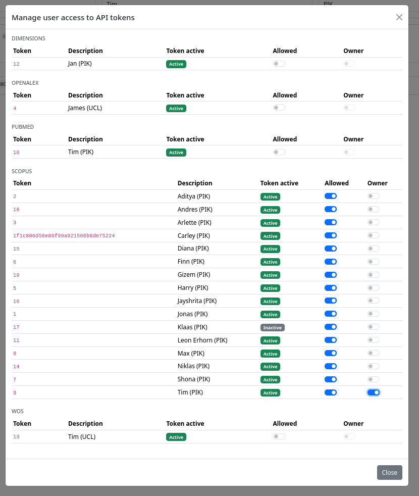

# Managing account, tokens and users

Everything that is not a query lives on three pages: **Profile** (your own account),
**Tokens** (the API keys the workers fetch with) and **Users** (administration, only
visible to administrators).

## My account

*Navigation: **Profile**.*

The profile page shows the fields attached to your login:

| Field | Editable | Notes |
| --- | --- | --- |
| User ID | no | Shown at the top as `Signed in as …`, used in permission dialogs |
| E-mail | yes | This is your login name |
| Full name | yes | Shown in the navigation bar and in user lists |
| Institution | yes | Free text |
| Password | with **Change password** ticked | Leave the box unticked to keep your current password |

Changes are only sent when you click **Save**.

!!! warning "Restricted fields"

    Whether an account is *active*, and its *query* and *admin* permissions, can only be
    changed by an administrator on the [Users](#users-administrators-only) page. The API
    rejects those fields when you edit your own profile.

## API tokens

*Navigation: **Tokens**.*

Workers pick keys from this shared pool for every request. As a token is used, the tool
records what the API reported back about its remaining quota, so the page doubles as a
budget dashboard.

Columns, per token (grouped by wrapper, sorted by description):

| Column | Meaning |
| --- | --- |
| **Token** | Internal token ID (a UUID), *not* the secret key, which is never displayed |
| **Description** | The comment you gave when adding the token |
| **Last used** | When this installation last sent a request with the token |
| **Locked until** | Until when the token is skipped by workers — green once the lock has expired, red while it is still active, grey when the token was never locked |
| **Active** | Switch to pause/resume the token; only shown to its owner or an administrator, everyone else sees a plain `true`/`false` |
| **Capacity** | Remaining quota from the last response (`remaining / limit`) plus a progress bar; the info icon expands the raw feedback below the row |
| **Actions** | **Delete** (two-stage confirmation), shown to the owner and to administrators |

!!! question "Why is my token locked?"

    When the API reports that the remaining quota dropped below one page of results (or
    `QUOTA_EXCEEDED`), the token is locked so that workers stop burning requests on it.
    The lock is released as soon as its timestamp lies in the past; the API's own reset
    time is used where it can be read, otherwise the tool falls back to two days. There
    is no button to clear a lock — wait for it to expire, or use another token.

### Adding a token

Click **Add token** in the top right and fill in the dialog:

* **Wrapper** — which API the key belongs to. Only `scopus` works end to end today;
  `pubmed` already has a wrapper in the API but cannot be submitted from the UI yet, and
  `wos`, `dimensions` and `openalex` are placeholders in the selection.
* **Token** — the secret key. It is stored, never shown again, and cannot be read back
  through the API.
* **Description** — required; this is how the token is labelled everywhere in the UI, so
  choose something meaningful ("inst-scopus-2026-1").
* **Proxy** — optional, e.g. `http://proxy.example.org:3128`, for installations that
  must reach the API through a proxy.

**Save** stays disabled until wrapper, token and description are filled in. Saving also
grants you **ownership** of the new token, so it appears in your list already editable.

!!! warning "Anyone may add tokens"

    Submitting a token is not restricted to administrators — everybody who can log in can
    contribute a key and becomes its owner. Deleting tokens, in contrast, is
    admin-only; the delete button shown to owners therefore fails with a permission error
    unless they are also administrators. Users can deactivate their own token, so it is
    not used by workers until it's activated again.
    Nobody can ever see your actual token (only a root user who has full server access could read the database).

### What the capacity numbers tell you (and what they don't)

The capacity column and the raw feedback are a snapshot of the rate-limit headers
(`x-ratelimit-limit`, `x-ratelimit-remaining`, `x-ratelimit-reset`, `x-els-status`, plus
the HTTP `status` and, on errors, the response `message`) stored **on the last use from
this installation**. The bar relates the remaining requests to the limit; when the token
is not a Scopus one, or has never answered, the column stays empty. The moment the quota
resets is only visible in the raw feedback, as a Unix timestamp in
`scopus_requests_reset`.

!!! warning "Feedback can be outdated"

    The same key is often used elsewhere — in a notebook, on another machine, by a
    colleague's personal search. Nothing of that shows up here, so treat the numbers as a
    lower bound of what is left, and the "Last used" column as "last used *here*".

### Who may change what

| Action | Owner | Administrator | Other users |
| --- | --- | --- | --- |
| See the token in the list | yes | yes — all tokens, including inactive ones | only tokens granted to them, and only active ones |
| Pause / resume (`Active`) | yes | yes | no |
| Change other fields (proxy, comment, secret) | no | yes | no |
| Delete | no — the button is shown, but the API rejects it | yes | no |
| Grant or revoke access for other users | no | yes | no |
| Use it for a query test or a download | yes | yes | yes, once access has been granted |

### How a token is picked

For every request, workers choose the **least recently used** token that

* belongs to the right wrapper,
* is **active**,
* is not currently locked, and
* is one the **owner of the query** has permission to use.

That last rule is the one that bites: if a colleague submits a query and you own the
tokens, someone must grant the *submitter* access to a token — otherwise their tasks fail
with `No active API token available for the owner of the query.`

## Users (administrators only)

*Navigation: **Users**.*

One card per account, all of them editable on the spot:

* **Switches** — *Active* (can the account log in at all), *Query permission* (may submit
  queries), *Admin permission* (sees this page, may delete queries and manage tokens).
* :bookmark: **Manage user access to API tokens** — opens the [token
  permissions](#token-permissions-for-a-user) dialog.
* :key: **Generate new password** — writes a random 16-character password into the card.
* :floppy_disk: **Save** — sends this one card to the API.

!!! info "Nothing is saved until you press Save"

    Edits live in an unsaved draft per card; leaving the page discards them. Each card is
    saved on its own, so a mistake on one card does not affect the others.

### Creating a user and handing out passwords

**New user** appends an empty card that already carries a generated password. Fill in at
least the e-mail (the login name) and the full name, then **Save** — only that click
reaches the API, and it is where the account gets its ID.

The generated password is shown below the fields as *New password (applied when saving)*,
with a copy button, until the card is saved; after saving it disappears from the screen
and becomes the account's password. Copy it into your message to the person **before**
saving. The same button works as a password reset for existing accounts.

The passwords use the full keyboard range (upper/lower case, digits and special
characters), so they satisfy the tool's hashing without needing rules — but they are
awkward to type, which is why they are selectable and copyable in one click.

!!! tip "New users need to be saved first"

    A brand-new card has no user ID yet, so token permissions cannot be attached to it.
    Save first, then open the token dialog.

### Token permissions for a user

The :bookmark: button on a card opens a dialog listing every token in the pool, grouped
by wrapper:

| Column | Meaning |
| --- | --- |
| **Token** / **Description** | Token ID and comment |
| **Token active** | Whether the token itself is currently active (read-only badge) |
| **Allowed** | The user may use this token — for their own queries and for tests |
| **Owner** | The user may pause the token and see it as theirs; disabled until *Allowed* is on, because ownership requires access |

Unlike the user card itself, **these switches take effect immediately** — there is no save
button, and the dialog stays open so you can work through the list. Turning *Allowed* off
revokes the permission outright; the owner switch on its own never removes access.
