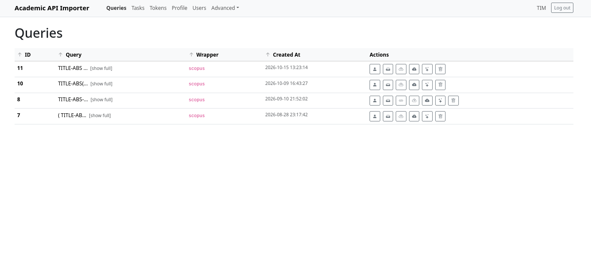
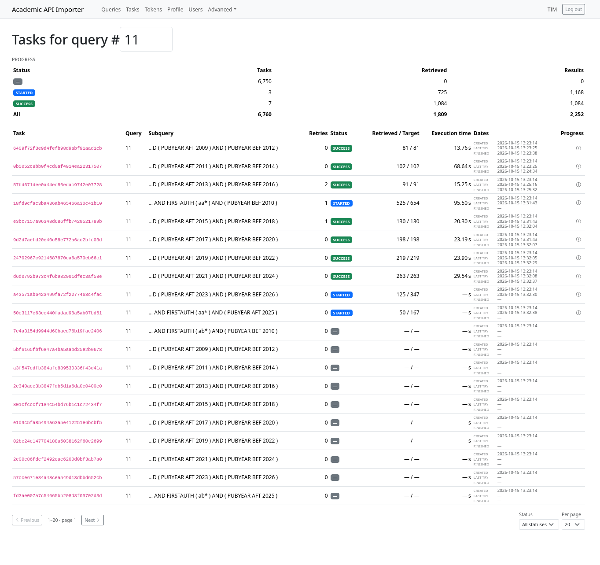
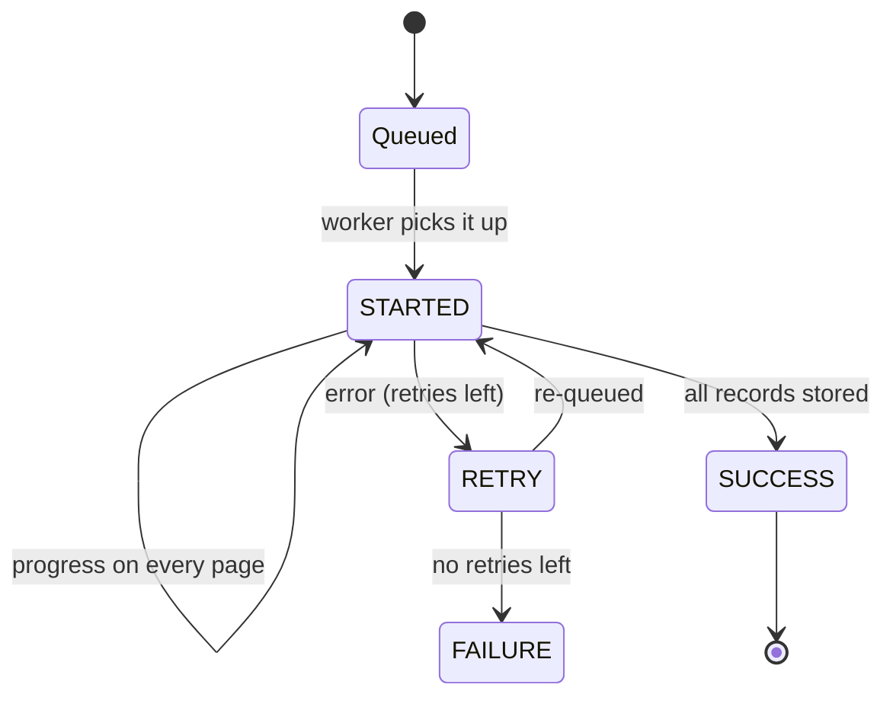

# Monitoring queries and tasks

Two pages tell you what happened to a query: the **Queries** list (one row per query you
may see) and the **Tasks** table (one row per sub-query job).

## Queries

*Navigation: **Queries** (`/queries`).*

The table lists ID, the query itself, wrapper and creation date, and is sortable by
clicking the headers. Long queries are shortened to their first characters; **[show
full]** opens the complete text in a dialog. Without admin rights you only see the
queries you have been given access to — which is every query you submitted yourself,
since submitting makes you its owner.

Each row has these actions:

| Action                             | What it does                                                                                                   | Who may do it      |
|------------------------------------|----------------------------------------------------------------------------------------------------------------|--------------------|
| **Manage access**                  | Open the [permissions](#sharing-a-query) dialog for this query                                                 | owner or admin     |
| **View tasks**                     | Jump to the [Tasks page](#tasks) filtered to this query                                                        | anyone with access |
| **Cloud links**                    | Show or hide the download links; only appears once links exist, and the ↻ button inside regenerates them       | owner or admin     |
| **Sync with cloud**                | Upload the query's whole result folder to cloud storage and return access links                                | admin              |
| **Sync with cloud (concatenated)** | Same, but all subqueries are merged into one big file (and `responses.log` and `responses.err` are not synced) | admin              |
| **Delete logs**                    | Remove the `.log` and `.err` files of the query, keeping the `.jsonl` results                                  | owner              |
| **Delete query**                   | Remove the query, its tasks and permissions from the database **and delete all its files**                     | admin              |

!!! note "Buttons you can see but not always use"

    *Manage access*, *Delete logs* and *Delete query* are rendered on every row, but the
    server only accepts them from the owner of that query (first two) or from an
    administrator (all three). Everyone else just gets a permission error as a toast. The
    two sync buttons, in contrast, are only rendered to administrators at all.

!!! warning "Two-stage confirmation, and deletion is final"

    The sync, log and delete buttons ask for confirmation (**Yes**/**No**) before running.
    Deleting a query runs in the background and removes the downloaded records from the
    server — there is no trash can. Downloading the results, or at least syncing them to
    cloud storage, first is a good idea.

!!! warning "Cloud visibility"

    You can only view/download files through the Azure cloud. The links contain a SAS token
    that lets you access the data. This token is not valid for long, so you may need to click
    the refresh button to get a new valid token. 
    
    Also note, that other users, knowing your query ID, could use their token to view your data.
    Within the user interface and API, this is not possible, but SAS tokens cannot be constrained
    to a single folder in an azure blob storage, so theoretically, everyone can see everything that was synced.

### Downloading results

Syncing does not stream anything to your browser: it queues an upload of the query's
result folder to the configured cloud storage and returns **time-limited access links**
(by default valid for 24 hours) for the whole folder, a browsable listing, the merged
records, the merged log and the errors. They are shown under the query text once they
exist, and the ↻ button creates fresh ones when they have expired — that button uploads
nothing.

!!! warning "Re-syncing does not overwrite"

    Files that already exist in the cloud are **skipped**, so a second sync only uploads
    what is new. Re-running the sync after fixing failed tasks will therefore keep the
    old copies of files that changed; use the concatenated variant (new file name) or ask
    an administrator to remove the previous upload.

### Sharing a query

*Manage access* lists every user with two switches:

* **Has access** — the user can see the query and its tasks. Switching it off revokes
  access immediately.
* **Is owner** — the user can then manage access themselves and hand the ownership on.
  Ownership requires access, so the switch is disabled until *Has access* is on.

Changes are saved as you flip the switches; the dialog always reflects what is stored.

## Tasks

*Navigation: **Tasks** (`/tasks`), or via **View tasks** on a query row (`/tasks/<query_id>`).*

Without a query ID the table shows **all** tasks belonging to queries you have permission
to see. Type a query ID into the heading (or arrive through *View tasks*) and a progress
summary appears above the list.

### Progress summary

One row per task status, with the number of tasks in that status, the records retrieved so
far, and the number of records the sub-queries report as their target size — plus a total
row, e.g.:

| Status  |   Tasks |   Retrieved |     Results |
|---------|--------:|------------:|------------:|
| STARTED |      12 |       3,410 |       5,986 |
| RETRY   |       3 |          75 |          75 |
| SUCCESS |     661 |     180,244 |     182,010 |
| **All** | **676** | **183,729** | **188,071** |

!!! note "Why 'Results' can be too high"

    The target size is the hit count each sub-query got from the API. Sub-queries overlap
    whenever the same record matches two of them, so the summed target counts such
    duplicates — it is an upper bound of what the query will yield, whereas *Retrieved* is
    what has actually been downloaded.

### The task rows

| Column                 | Content                                                                                                                                                                                                 |
|------------------------|---------------------------------------------------------------------------------------------------------------------------------------------------------------------------------------------------------|
| **Task**               | The task ID (a UUID)                                                                                                                                                                                    |
| **Query**              | The query it belongs to                                                                                                                                                                                 |
| **Subquery**           | The **tail** of the sub-query: the last few characters, prefixed with `...` (the API shortens it to 50 characters), because the distinguishing part — the year and first-author filters — is at the end |
| **Retries**            | How often this task has already failed and been re-queued                                                                                                                                               |
| **Status**             | Badge: blue `STARTED`, amber `RETRY`, green `SUCCESS`, red `FAILURE`, grey `—` while still queued                                                                                                       |
| **Retrieved / Target** | Records fetched so far / records the API says the sub-query has                                                                                                                                         |
| **Execution time**     | Seconds the last attempt took                                                                                                                                                                           |
| **Dates**              | Created, last try, finished                                                                                                                                                                             |
| **Progress**           | The info icon expands the raw progress payload of the task                                                                                                                                              |

Two filters sit under the table: **Status** (all, or one of the four states) and **Per
page** (10, 20, 50, 100), with Previous/Next paging. Changing either jumps back to the
first page.

### Task states and retries

A task is created as **queued** (blank status), turns **STARTED** when a worker picks it up
and keeps updating that state with its progress on every fetched page. On failure it is
re-queued as **RETRY** and stays there until it either succeeds (**SUCCESS**) or runs out
of attempts (**FAILURE**, after five retries by default):

Individual API errors are handled inside a task first: server errors (500/502/503/504)
are retried with a growing wait between requests, and if the API reports that the quota is
used up, the token is locked so the next attempt gets a different one. A `FAILURE` is
therefore usually a persistent problem — a bad query, a key without budget, or the API
rejecting that particular slice.

!!! tip "Where the failure details are"

    Expand the raw progress payload with the info icon: it holds the record counts and the
    **last API feedback** the task received — the rate-limit headers and error message of
    the final response. Each task also writes its own log file, and failures their `.err`
    file, under `data/results/<query_id>/responses/<task_id>.log` and `.err`; retried
    attempts are appended below a `--- TASK RESTARTED ---` marker. Administrators can pull
    these files through the *sync* buttons on the [Queries page](#queries), and the
    *Delete logs* action clears them again once you are done.

??? info "Restarting a stalled run"

    Tasks are re-delivered from the queue while they are not finished and have retries
    left, so a worker or API restart picks up unfinished work on its own — the point of the
    sub-query split is that a restart costs at most the tasks that were in flight, not the
    whole download.
