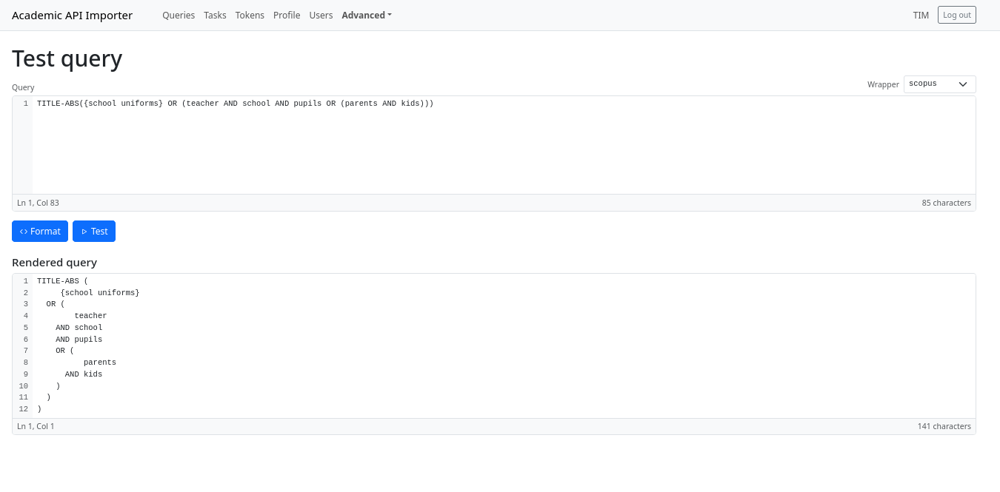
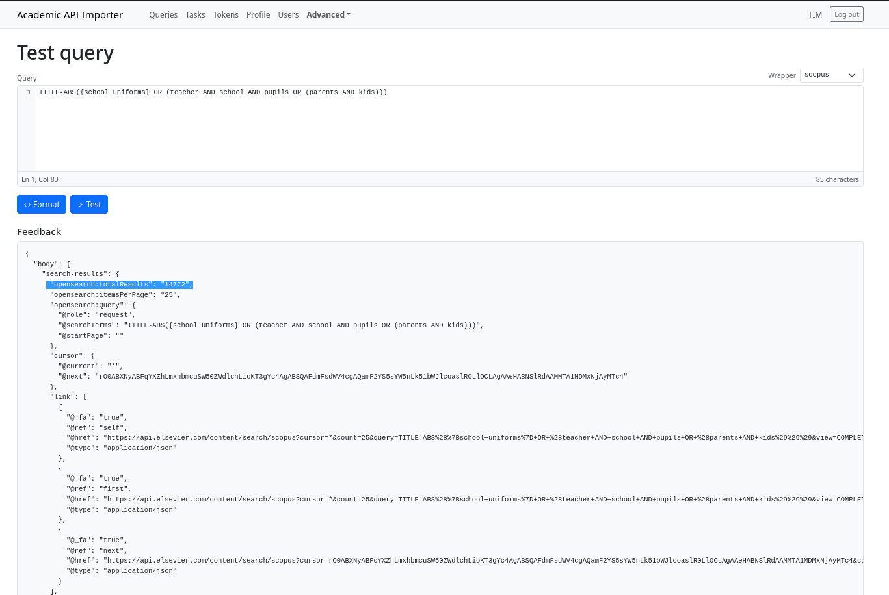
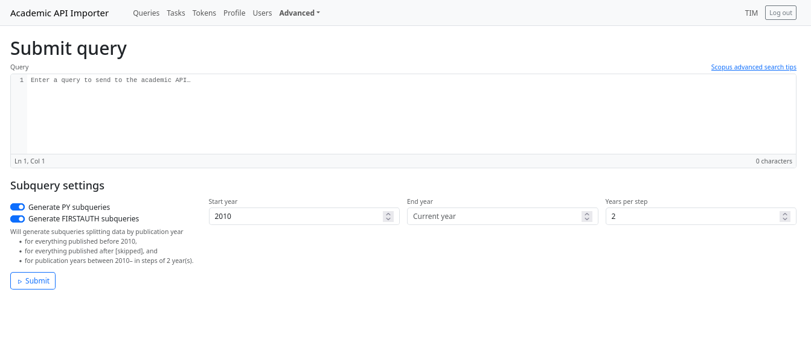

# Checking and submitting queries

Both pages live under **Advanced** in the navigation bar, because they are the two steps
you take *before* a query becomes a running job.

## Query utils

*Navigation: **Advanced → Query utils** (`/queries/utils`).*

A scratch pad for a single query: a large text field, a wrapper selector, and two
buttons — **Format** and **Test**.



The draft is kept in your browser (in `localStorage`, flushed when the tab goes away), so
it survives a reload or a closed tab. It is cleared when you log out, and it is *not*
shared with the submit page.

### Format

**Format** parses the query with the tool's own grammar and prints it back as indented
text in the *Rendered query* box: one term per line, every parenthesis kept, and the
operator placed in front of the line it introduces.

=== "Input"

    ```
    TITLE-ABS((climate AND health) OR (adaptation OR mitigation)) AND PUBYEAR AFT 2015 AND AU-ID("55123456789") AND NOT DOCTYPE(12)
    ```

=== "Formatted"

    ```
    TITLE-ABS (
      (
            climate
        AND health
      )
      OR (
           adaptation
        OR mitigation
      )
    )
    AND     PUBYEAR AFT 2015
    AND AU-ID (
      "55123456789"
    )
    AND NOT DOCTYPE (
      12
    )
    ```

This is more than cosmetics:

* **Finding mistakes** — unbalanced parentheses and forgotten operators hide in a
  three-hundred-character one-liner; with one term per line and visible indentation the
  broken group is obvious.
* **Reading other people's queries** — the nesting of `AND`/`OR` blocks becomes visible.
* **Reviewing changes** — reformatted queries diff cleanly, so a git commit or pull
  request shows exactly which term was added or removed.
* **Copying back** — the rendered text is a valid query again, so you can keep the
  formatted version as your working copy.

Formatting is currently implemented for **Scopus** only; other wrappers answer with
`Formatting not available for <wrapper>`.

#### Syntax errors

Because the query is parsed rather than handed to the API, errors come back with a
position and a hint instead of the generic `invalid query` response the API produces:

```
The query ended too early.

AND health) OR TITLE-ABS(adaptation AND mitigation
                                        ^

There may be a missing ")".

Expected one of:
  - a search term, e.g. heart or child*
  - a loose phrase, e.g. "heart attack"
  - an exact phrase, e.g. {heart attack}
  - a reference sub-field: REFARTNUM(...), REFAUTH(...), REFPAGE(...), ...
  - a reference-year filter, e.g. REFPUBYEAR IS 1859
  - "(" to open a group
  - a Boolean operator: AND, OR, AND NOT
  - a proximity operator, e.g. W/3 or PRE/2
  - ")" to close the group
```

The message always names line and column, quotes a short piece of the query around the
problem with a `^` marker, and lists what could legally follow. Other hints you may see:

> `There may be a missing ")".`
>
> `<WORD>(...) is not allowed here. Field codes cannot be nested; only REF(...) may contain ...`
>
> `"xyz" is not a valid code here. Did you mean TITLE-ABS-KEY ...?`
>
> `An operator (AND, OR, AND NOT, W/n, PRE/n) may be missing before this word.`

Under the hood is a LALR grammar in
[`src/academic_apis/grammars/scopus.lark`](https://github.com/destiny-evidence/academic-api-importer/blob/main/src/academic_apis/grammars/scopus.lark),
implemented by `src/academic_apis/grammars/scopus.py`. It follows Elsevier's
*[How can I best use the Advanced search?](https://www.elsevier.support/scopus/answer/how-can-i-best-use-the-advanced-search)*
guidance (field codes, `REF(...)` with sub-fields, `PUBYEAR`/`REFPUBYEAR`/`LOAD-DATE`
comparisons with `BEF`/`AFT`/`IS`, `W/n` and `PRE/n` proximity, `"loose phrases"`,
`{exact phrases}`, wildcards, top-level `NOT`) and is kept in sync with it, so it can be
treated as the authoritative syntax reference for what this tool accepts.

??? info "Future plans to improve the query utils"

    * Translating queries **between search providers** where the syntax overlaps.
    * **Query analysis**: showing which terms contribute to the result count, so you can
      see what a filter actually removes before you pay for the download.

### Test



**Test** sends the query to the real API and returns the **first page of the first
response** — body, headers and status code — in the *Feedback* box. Use it to confirm
that the query is accepted and that the hit count (`metaData > search-results > entries`)
is plausible before submitting.

The request is made with one of **your own** active tokens (the least recently used one),
so:

!!! warning "Testing costs real budget"

    A test is a normal API request: it consumes one request of that token's quota and
    updates the token's capacity and lock state exactly like a download would. If no
    active token is granted to you, the test fails with *You do not have access to any
    active auth token.*

## Submit query

*Navigation: **Advanced → Submit query** (`/queries/submit`).*



The query editor is the same as on the utils page, with a link to the Scopus advanced
search tips next to it. Below it, the **Subquery settings** decide how the query is cut
into tasks:

| Setting | Default | Effect |
| --- | --- | --- |
| **Generate PY subqueries** | on | Split by publication year using the three year fields |
| **Generate FIRSTAUTH subqueries** | on | One sub-query per first-author pair `aa*` … `zz*` |
| **Start year** | 2010 | Everything published *before* this year becomes its own sub-query |
| **End year** | current year | Everything published *after* it becomes its own sub-query |
| **Years per step** | 2 | Width of the year windows in between |

Both loops are optional and independent. In pseudo-code:

```
for firstauth in aa* ... zz*:              # if FIRSTAUTH sub-queries are generated
    for year window:                       # if PY sub-queries are generated
        request: query + author filter + year filter
```

For Scopus the filters are `FIRSTAUTH ( xy* )` and `PUBYEAR AFT … / BEF …`, and the year
range is cut into a "before the start year" slice, fixed windows, and an "after the last
year" slice. With start 2010, end 2014 and step 2 the generator yields:

```
( TITLE-ABS(climate) ) AND ( PUBYEAR BEF 2010 )
( TITLE-ABS(climate) ) AND ( PUBYEAR AFT 2009 ) AND ( PUBYEAR BEF 2012 )
( TITLE-ABS(climate) ) AND ( PUBYEAR AFT 2011 ) AND ( PUBYEAR BEF 2014 )
( TITLE-ABS(climate) ) AND ( PUBYEAR AFT 2013 )
```

!!! warning "The number of tasks multiplies fast"

    Author splitting is 26 × 26 = **676** sub-queries on its own. Combined with a
    2010–2025 range in two-year steps that is **6,760** tasks — and every task is at least
    one API request, plus one per 25 records retrieved. Check your token budget against
    the *Will generate subqueries …* summary above the button, and turn one of the two
    splitters off if you do not need it.

    The splitting exists to keep each task small enough to finish and to be re-tried on
    its own — not to reduce the number of requests.

**Submit** is a confirmation button, and the submission itself happens in the background:
a toast tells you the query was put on the queue, and it can take a few minutes before it
shows up on the [Queries page](query-monitor.md). You automatically become the **owner**
of the new query, which is what ties it to your tokens and lets you manage who else can
see it.

!!! note "Who may submit"

    The form is shown when your account has the *Query permission*. The API currently
    refuses submissions unless the account is an administrator as well, so if the form is
    visible but submitting answers *You do not have the permission to submit queries*,
    ask for admin rights (or have an administrator run the submission).

### Bypassing the generator

The web form always uses the built-in generator. If you want full control over the slices,
`POST /queries` also accepts an explicit list:

```json
{
  "query": { "query": "TITLE-ABS(climate)", "wrapper": "scopus" },
  "queries": [
    { "query": "TITLE-ABS(climate) AND PUBYEAR AFT 2020", "wrapper": "scopus", "params": {} },
    { "query": "TITLE-ABS(climate) AND PUBYEAR BEF 2000", "wrapper": "scopus" }
  ]
}
```

Each entry is queued as a task **as it is** — no splitting — and every entry must use the
same wrapper as the parent query. The year and filter settings are ordinary query
parameters (`?use_py_filter=false&use_firstauth_filter=false`), and the optional `params`
of each entry are forwarded to the API call, so this is also how you attach wrapper
options the form does not expose. This is the hook for splitting strategies smarter than a
plain year or author loop — for example one slice per journal, per country or per
funding agency.

??? info "Planned: quasi-sampling downloads"

    A mode that deliberately fetches only a *sample* of the results, e.g. to check query
    coverage or to compare what different parts of a query return before committing the
    full download budget to it.
